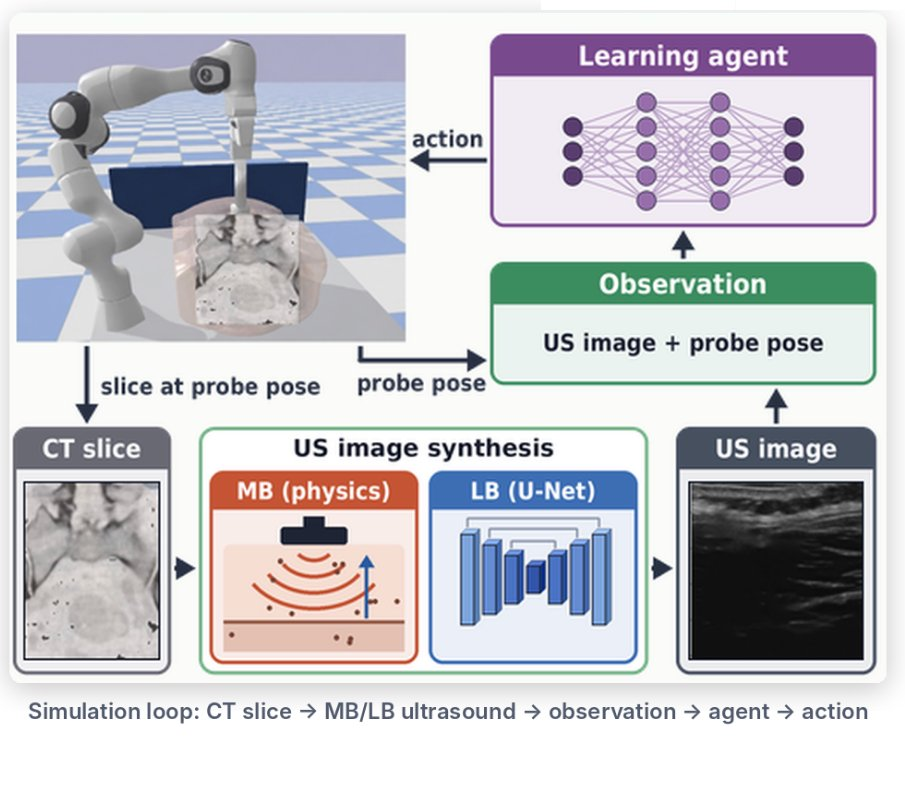

# SonoGymLite: Lightweight Simulator for Learning Autonomous Robotic Ultrasound

<div align="center">

[](https://www.python.org/downloads/)
[](https://gymnasium.farama.org/)
[](https://pybullet.org/)
[](https://opensource.org/licenses/MIT)

**Lakshay Batta and Deepak Raina**

<br>



</div>

---

## 📖 Overview

**SonoGymLite** is a lightweight, accessible, CPU-friendly robotic ultrasound simulation environment designed for developing and evaluating autonomous ultrasound scanning policies. Built on **PyBullet** physics and **OpenAI Gymnasium**, SonoGymLite couples Franka Emika Panda manipulator kinematics with realistic ultrasound physics and compliant clinical surface contact modeling.

Unlike traditional GPU-intensive simulators, SonoGymLite executes at **50–120 steps/second on standard commodity CPUs**, enabling a complete 100,000-step reinforcement learning training run in under **35 minutes** without requiring specialized GPU clusters.

```text
                                       ┌────────────────────────────────┐
                                       │     Patient CT Volumes         │
                                       │    (TotalSegmentator N=5)      │
                                       └──────────────┬─────────────────┘
                                                      │
                       ┌──────────────────────────────┴──────────────────────────────┐
                       ▼                                                             ▼
        ┌─────────────────────────────┐                               ┌─────────────────────────────┐
        │   Physics Ultrasound Engine │                               │   Learning-Based Generator  │
        │  Vectorized Ray-Convolution │                               │  2-Channel Deep Spine U-Net │
        │     (50–120 FPS on CPU)     │                               │   (Cavalcanti Clinical US)  │
        └──────────────┬──────────────┘                               └──────────────┬──────────────┘
                       │                                                             │
                       └──────────────────────────────┬──────────────────────────────┘
                                                      │
                                                      ▼
                                       ┌────────────────────────────────┐
                                       │    Gymnasium Environment       │
                                       │     (RoboticUltrasound-v0)     │
                                       └──────────────┬─────────────────┘
                                                      │
         ┌────────────────────────────────────────────┼────────────────────────────────────────────┐
         ▼                                            ▼                                            ▼
┌──────────────────────────────┐       ┌──────────────────────────────┐       ┌──────────────────────────────┐
│   Task 1: Navigation         │       │   Task 2: Reconstruction     │       │   Task 3: Needle Guidance    │
│ • Goal-Conditioned Alignment │       │ • Trajectory Coverage Sweep  │       │ • Probe-Mounted Guide (URDF) │
│ • 2–8N Compliant Force Window│       │ • Downstream 3D Compounding  │       │ • Specular Visibility Law    │
│ • PPO, SAC, A2C, ACT, BC     │       │ • Watertight Marching Cubes  │       │ • CT Bone Corridor Planning  │
└──────────────────────────────┘       └──────────────────────────────┘       └──────────────────────────────┘
```

---

## 🌟 Key Features

1. **High-Throughput CPU Simulation:**
   - **Workstation:** $120.1\,\text{steps/s}$ ($8.3\,\text{ms/step}$).
   - **Laptop (Apple M1):** $48.4\text{--}65.6\,\text{steps/s}$ ($15.2\text{--}24.9\,\text{ms/step}$).
   - Fast enough to run 100,000 steps of reinforcement learning in 14–35 minutes on standard hardware.

2. **Compliant Surface Contact Modeling:**
   - Kinematic surface-following controller ($k = 800\,\text{N/m}$, nominal $2.0\,\text{mm}$ indentation).
   - Guarantees strict clinical contact force bounds ($F \in [2, 8]\,\text{N}$, nominal $4.0\,\text{N}$) with zero internal mesh penetration.

3. **Dual Ultrasound Synthesis Engines:**
   - **Model-Based (MB):** Pure NumPy vectorized ray-tracing and convolution simulating Rayleigh speckle, bone reflection, acoustic shadows, and anechoic vascular fluid lumen (`US_LABEL_FLUID = 5`).
   - **Learning-Based (LB):** 2-channel deep U-Net / Pix2Pix GAN trained on real clinical volunteer sweeps (Cavalcanti Spine Dataset).

4. **Three Clinical Benchmark Tasks:**
   - **Task 1 (Navigation):** Autonomous alignment of the ultrasound beam with anatomical landmarks (Lumbar Spine L4, Liver Portal Vein, Abdominal Aorta Bifurcation) across in-domain (`s0011`, `s0058`, `s0250`) and held-out test patients (`s0344`, `s0358`).
   - **Task 2 (3D Volumetric Reconstruction):** Autonomous sweeping trajectories (up to 97.3% coverage) coupled with deep U-Net slice segmentation and 3D voxel compounding, producing watertight surface meshes with sub-2 mm accuracy.
   - **Task 3 (Dual-Stage Needle Guidance):** Biopsy guide attachment (`robotic_probe_needle_guide.urdf`) with in-plane ultrasound needle visualization, specular reflection physics ($V = \cos\theta$), 24-azimuth bone corridor planning, and deflection compensation.

---

## 🛠️ Installation

### 1. Clone the Repository
```bash
git clone https://github.com/lakshay-ctrl/SonoGymLite.git
cd SonoGymLite
```

### 2. Set Up Environment
We recommend Python 3.10, 3.11, or 3.12:
```bash
conda create -n sonogym python=3.11 -y
conda activate sonogym

pip install -r requirements.txt
```

### 3. Download Pretrained Policy Checkpoints (Optional)
To evaluate the pre-trained SAC, PPO, and ACT policies without re-training:
```bash
chmod +x scripts/download_weights.sh
./scripts/download_weights.sh
```

---

## 🚀 Quickstart & Interactive Demos

### 1. Interactive Needle Guidance Visualizer (Task 3)
Launch the multi-viewport visualizer showing 3D PyBullet world, live CT cross-section with bone corridors, and real-time synthesized B-mode ultrasound:
```bash
python3 live_needle_experiment.py --anatomy aorta --angle 45
```
**Keyboard Controls:**
- `[1]` / `[2]` / `[3]` : Switch guide angle (30° / 45° / 60°)
- `[SPACE]` : Toggle automatic needle insertion to target
- `[E]` / `[Q]` : Advance / retract cannula manually
- `[C]` : Toggle closed-loop deflection visual servoing (<1 mm tip error)
- `[O]` : Toggle organ (Aorta Bifurcation $\leftrightarrow$ Liver Portal Vein)
- `[P]` : Cycle patient cohort (`s0058` $\to$ `s0011` $\to$ `s0250` $\to$ `s0344` $\to$ `s0358`)
- `[ESC]` : Exit visualizer

### 2. 1-Click Broadcast Video Showcase Generator
Generate a 1536x742 HD video showcasing safe acoustic corridor planning, smooth 45° cannula advance, target lock in aorta lumen, and multi-angle visibility:
```bash
python3 record_needle_showcase.py --output needle_guidance_showcase.mp4
```

### 3. Gymnasium Environment Verification
Verify that the simulation environment and physics step cleanly:
```bash
python3 test_gym_env.py --headless
```

### 4. Interactive Ultrasound Scanning Simulator
Manually control the robot probe over the patient body with real-time B-mode ultrasound feedback:
```bash
python3 live_unet_demo.py --sim-mode conv --anatomy spine
```

---

## 🏋️ Training Reinforcement Learning Agents

### Train Navigation Agents (Task 1)
```bash
# Train PPO on Spine with Multi-Patient Domain Randomization
python3 train_ppo.py --timesteps 100000 --task navigation --anatomy spine --sim-mode conv --multi-patient

# Train SAC on Liver Portal Vein
python3 train_sac.py --timesteps 50000 --task navigation --anatomy liver --sim-mode conv --buffer-size 10000

# Train on Abdominal Aorta (Supine Orientation)
python3 train_aorta_gpu.py --algo ppo --timesteps 100000 --multi-patient
```

### Train Imitation Learning Agents
```bash
# Train Action Chunking with Transformers (ACT) policy
python3 train_act.py --anatomy spine --epochs 50

# Train Behavioral Cloning (BC) baseline
python3 train_bc.py --anatomy spine --epochs 50
```

---

## 📊 Benchmarking & Reproducibility

Reproduce all experimental tables reported in the paper:

```bash
# Evaluate Multi-Algorithm Navigation Benchmark (Table 1)
python3 run_full_benchmark.py --episodes 5

# Compare Reconstruction Sweeping Strategies (Figure 4 & Table 2)
python3 compare_reconstruction_sweep.py --max-steps 150

# Run Needle Feasibility & Acoustic Visibility Verification (Table 4)
python3 scripts/step5_needle_verify.py --all

# Run End-to-End Navigation-to-Needle Hit Rate Benchmark (Table 3)
python3 scripts/step5b_needle_nav_hit.py --reference-only
```

All raw outputs and summary tables are automatically logged to `results/`.

---

## 📁 Repository Structure

```text
SonoGymLite/
├── robotic_us_env.py                       # Core Gymnasium environment (RoboticUltrasound-v0)
├── live_unet_demo.py                       # Central simulation hub & Model-Based US synthesizer
├── surface_motion_planner.py               # Compliant surface normal controller & height maps
├── extract_slice.py                        # Oblique/orthogonal CT and segmentation reslicer
├── registration.py                         # Voxel-to-world coordinate transformations
├── image_quality_metric.py                 # MICCAI speckle statistics & acoustic shadow metric
├── robotic_probe_needle_guide.urdf         # Mechatronic probe + needle guide CAD model
├── live_needle_experiment.py               # Interactive visualizer + direct MP4 video recorder
├── record_needle_showcase.py               # 1-click automated HD video showcase generator
├── test_gym_env.py                         # Environment sanity test & FPS benchmark
├── train_ppo.py, train_sac.py, train_act.py# RL & IL policy training scripts
├── eval_sonogym_benchmark.py               # Multi-algorithm benchmark suite
├── run_full_benchmark.py                   # Master evaluation runner (Table 1)
├── evaluate_needle_study.py                # Multi-patient needle insertion benchmark
├── scripts/
│   ├── download_weights.sh                 # Pretrained checkpoint downloader
│   ├── step5_needle_verify.py              # Geometric & acoustic feasibility verification (N1-N5)
│   ├── step5b_needle_nav_hit.py            # Navigation-to-needle hit rate coupling benchmark
│   └── generate_publication_reconstruction_figure.py
├── results/                                # 40+ empirical benchmark JSONs, tables, and reports
├── aorta_bifurcation_targets.json          # 6-DoF target database for Aorta Bifurcation
├── portal_vein_targets.json                # 6-DoF target database for Liver Portal Vein
├── l4_svp_targets.json                     # 6-DoF target database for Lumbar Spine L4
├── totalseg_patients/                      # 5-patient cohort (s0011, s0058, s0250, s0344, s0358)
│   └── s0058/                              # Sample reference patient assets (CT, mesh, bone, maps)
├── requirements.txt                        # Python dependencies
└── LICENSE                                 # MIT License
```

---

## 📜 Citation

If you use SonoGymLite in your research, please cite:

```bibtex
@article{batta2026sonogymlite,
  title={SonoGymLite: Lightweight Simulator for Learning Autonomous Robotic Ultrasound},
  author={Batta, Lakshay and Raina, Deepak},
  note={Preprint / Code Release},
  year={2026}
}
```

---

## 📄 License
This project is licensed under the MIT License - see the [LICENSE](LICENSE) file for details.
